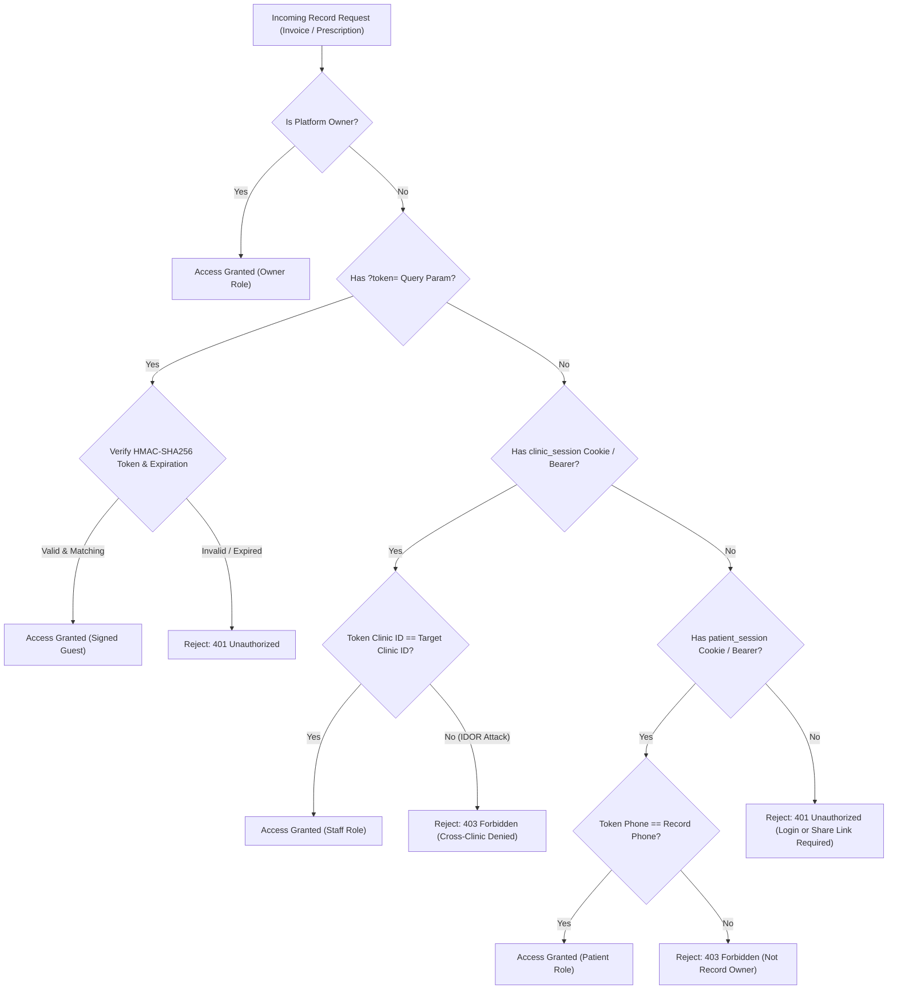

# Security Audit & Hardening Report
**Audit Scope:** Authentication, Authorization, Tenant Isolation, Firestore Rules, Cryptography, and Secret Elimination.

---

## 1. Vulnerability Findings & Remediation

| Issue ID | Severity | Description | Resolution Status | Technical Remediation |
| :--- | :--- | :--- | :--- | :--- |
| **SEC-01** | **P0 (Critical)** | Hardcoded administrative deploy secret `yalla-secret-deploy-2026` in `/api/admin/deploy-rules`, `/api/admin/rotate-credentials`, and `/api/admin/seed-clinics`. | **RESOLVED** | Completely deleted secret check. Required `authenticateOwnerRequest` verifying `OWNER_COOKIE` or Firebase Owner ID token against `PLATFORM_OWNER_UID`. Audit logs recorded for every operation. |
| **SEC-02** | **P0 (Critical)** | Public unauthenticated access and IDOR vulnerability on `/api/clinic/[slug]/invoice/[invoiceId]` and `/api/clinic/[slug]/prescription/[appointmentId]`. | **RESOLVED** | Implemented `authorizeRecordAccess` in `src/lib/server/record-access.ts`. Enforces role-based checks (Owner, Clinic Staff for that clinic, Patient owning the record, or HMAC-SHA256 share token). Unauthorized requests return 401/403. |
| **SEC-03** | **P0 (Critical)** | Firestore Security Rules permitted public reading of `clinics/{clinicId}` documents which contain doctor and assistant credentials and password hashes. | **RESOLVED** | Updated `firestore.rules` so `clinics/{clinicId}` read is restricted to `isPlatformOwner() || (isAuthenticated() && isClinicTenant(clinicId))`. Public clients load sanitized settings via `/api/clinic/[slug]/settings` powered by server REST. |
| **SEC-04** | **P1 (High)** | Password cryptography relied on unsalted single-iteration SHA-256 with plaintext password acceptance fallback. | **RESOLVED** | Rewrote `src/lib/auth-crypto.ts` with PBKDF2 (100,000 iterations, Web Crypto API, unique 16-byte random salt). Plaintext matching completely abolished. Legacy SHA-256 hashes supported via timing-safe comparison. |
| **SEC-05** | **P1 (High)** | Hardcoded test credentials stored in public QA scripts (`scripts/run-live-browser-qa.mjs`, `scripts/run-complete-platform-test.mjs`, `scripts/seed-master-dataset.mjs`). | **RESOLVED** | Sanitized all scripts to consume `process.env.TEST_DOCTOR_PASSWORD`, `process.env.TEST_SECRETARY_PASSWORD`, and `process.env.TEST_PATIENT_PASSWORD`. Zero fallback credentials in repository code. |

---

## 2. Record Authorization Flow Diagram

---

## 3. Cryptographic Implementation Details

### PBKDF2 Format
- **Format:** `pbkdf2:100000:<saltHex>:<hashHex>`
- **Iterations:** 100,000 iterations using SHA-256
- **Salt:** 16 cryptographically secure random bytes generated via `crypto.getRandomValues(new Uint8Array(16))`
- **Hash Output:** 32 bytes (256 bits) derived via `crypto.subtle.deriveBits`

### Constant-Time Comparison
All password and token comparisons utilize `constantTimeCompare` XOR loop to eliminate timing attack side-channels.

### Share Tokens
- **Format:** `base64(clinicId:recordId:type:expiresAt:signatureHex)`
- **Signing Algorithm:** HMAC-SHA256
- **Default TTL:** 7 days (168 hours), strictly verified on server before record delivery.
